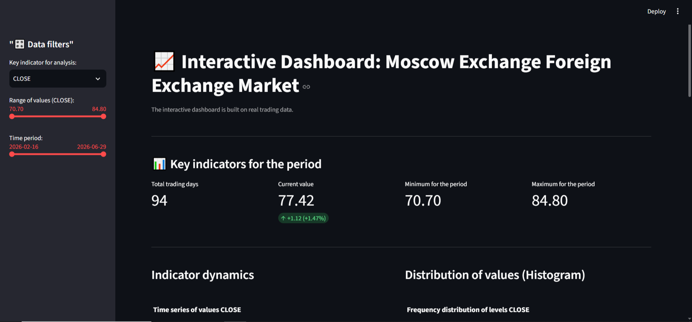
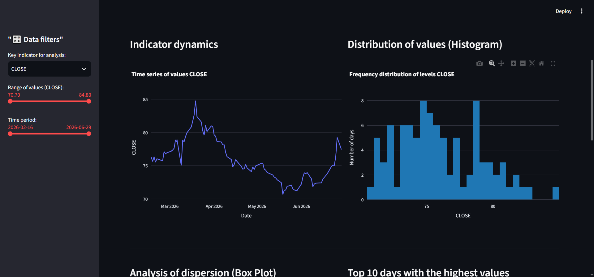

# 📈 Dynamic Forex & Market Analytics Dashboard

An enterprise-ready, interactive data visualization dashboard built with **Python**, **Streamlit**, and **Plotly**. It features a fully dynamic data architecture that automatically detects financial indicators, time series metrics, and statistical distributions from any transactional market dataset.

## 🖥️ Dashboard Interface Preview


## 💡 Business & Engineering Value
* **Zero-Configuration Architecture:** Automatically parses datetime indexes and filters numerical KPIs without hardcoded column mappings.
* **Exploratory Data Analysis (EDA):** Delivers instant business intelligence insights through time-series trends, frequency distribution histograms, and statistical dispersion (Box Plots).
* **Performance-Optimized:** Built leveraging Streamlit’s modern execution loop with vectorized pandas filters for instant reactive UI updates.

## ✨ Key Features & Deep-Dive Analytics
* **Dynamic Sidebar Controls:** Real-time filtering by flexible date ranges and specific metric thresholds.
* **Automated KPI Summary Cards:** Instant computation of period minimums, maximums, and rate of return (Delta % with conditional indicators).
* **Deep-Dive Statistical Visualizations:** High-fidelity interactive charts with one-click zoom, isolation, and export tools powered by Plotly.


*Statistical data distribution and dispersion analytics dashboards.*

# 📈 Dynamic Forex & Market Analytics Dashboard

An interactive data visualization dashboard built with **Python**, **Streamlit**, and **Plotly** for analyzing financial indicators and time series metrics.

## 🚀 Quick Start
1. Clone and run the repository:
   ```bash
   git clone https://github.com
   cd Dashboard-MOEX
   pip install -r requirements.txt
   streamlit run Dashboard.py
   ```

## 📄 License
Open-source under the [MIT License](LICENSE).


## 🛠️ Tech Stack
* **Framework:** Python / Streamlit
* **Data Processing:** Pandas / Pathlib
* **Data Visualization:** Plotly Express

## 🚀 Quick Start (Local Deployment)

1. **Clone the repository:**
   ```bash
   git clone https://github.com
   cd Dashboard-MOEX
   ```

2. **Install dependencies:**
   Make sure you have Python installed, then run:
   ```bash
   pip install -r requirements.txt
   ```

3. **Launch the application:**
   ```bash
   streamlit run Dashboard.py
   ```
   The dashboard will automatically open in your local browser at `http://localhost:8501`.

## 📄 License
This project is open-source and available under the [MIT License](LICENSE).
